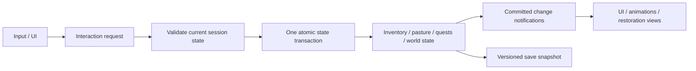

# 03 — Technical architecture

**Planning only — 2026-10-23 NZDT. No implementation code, Unity project, package manifest, scenes, or prefabs are created in Phase 0.**

## Small project structure

After the jam gate, create one Unity project at `game/` with a Universal 3D template. Proposed owned content is under `Assets/Echoes/`: Scenes, Scripts, Definitions, Prefabs, Art, Audio, UI, and Tests. This is a future layout, not directories to create now. Keep `.meta` files in Git; Force Text; never commit Library, Temp, builds, or credentials.

Use two scenes: **Boot** for title/session/load and **Valley** for play. One explicit scene flow loads a single session and tears it down when returning to title. The Valley contains simple prefab instances for player, resource node, NPC, workbench, chicken/pen, restoration visuals, and Canvas. Avoid additive streaming, Addressables, service locators, dependency-injection frameworks, ECS, or global event buses.

One session composition MonoBehaviour constructs the plain C# state/rule objects and passes references to Unity-facing components. MonoBehaviours handle input, physics, animation, audio, scene lookup, and UI. Plain classes handle quantities, transitions, eligibility, and transactions where useful. ScriptableObjects are immutable runtime definitions, never mutable save slots.

## Packages and rendering decisions

| Component | Intended use | Verification boundary |
| --- | --- | --- |
| Unity 6.3 LTS / 6000.3.x | Windows x64 editor/player | Missing locally; exact installed patch not available |
| URP, `com.unity.render-pipelines.universal` | Forward rendering, baked environment plus one sun | Core package tied to editor; do not arbitrarily force another graphics package version |
| Shader Graph, `com.unity.shadergraph` | One lightweight opaque anime surface family | Editor-aligned core package; no game shader authored yet |
| Input System, `com.unity.inputsystem` | Move, Look, Interact, Inventory, Pause, UI actions | Resolve released compatible version in selected editor; no samples/gameplay imports |
| Cinemachine, `com.unity.cinemachine` | One follow camera, obstruction and reset behavior | Official 6000.3 page lists 3.1.7 released; confirm resolver at kickoff |
| Test Framework, `com.unity.test-framework` | EditMode domain tests; PlayMode integration | Core package; runner not executed in Phase 0 |
| uGUI and TextMeshPro facilities | Compact Canvas UI and readable English text | Confirm shipped UI/text dependencies in editor; record necessary essential resources |

Official evidence: [6.3 core packages](https://docs.unity.com/en-us/engine/6000.3/manual/packages-list/packages-all/pack-core), [Cinemachine for 6.3](https://docs.unity.com/en-us/engine/6000.3/manual/packages-list/packages-all/pack-safe/com-unity-cinemachine), [Input System installation](https://github.com/Unity-Technologies/InputSystem/blob/develop/Packages/com.unity.inputsystem/Documentation~/Installation.md), [URP documentation](https://docs.unity3d.com/6000.3/Documentation/Manual/urp/urp-introduction.html). One legacy URP setup URL failed; package/editor readback remains required. Package versions are research, not an installed lockfile.

Initial player backend: Mono; Windows x64; Direct3D 11 as the conservative graphics baseline. Windows IL2CPP requires its matching build module, Visual Studio C++ tools, and Windows SDK; do not confuse UWP or Windows Server support with the desktop player. Native compiler and SDK are detected locally, but no Unity build has been attempted. [Unity requirements](https://docs.unity.com/en-us/engine/6000.3/manual/get-started/install-and-upgrade/getting-started-installing-unity/system-requirements)

## System ownership

| System | Owns | Unity integration and effects |
| --- | --- | --- |
| Interaction | Selected target, range/availability, request dispatch | Camera/range query, English prompt, one action per press; revalidate range at commit |
| Inventory/economy | Item stacks and integer coins | Inventory UI subscribes to committed changes; never writes quantities directly |
| Gathering | Stable node IDs and active-time cooldowns | Node prefab requests gather; depletion visuals follow success only |
| Pasture | Owned chicken ID, growth/feed/egg state, active elapsed time | Chicken/pen views display persisted state; frame updates do not invent rewards |
| Crafting | Recipe eligibility and cost/output calculation | Workbench sends one recipe request; inventory transaction owns actual mutation |
| Quests | Accepted/completed IDs and reward flags | NPC dialogue reads state; exact delivery is one command |
| World state | Integer restoration 0–3 and ending flag | Enables authored visual variants; load reapplies variants idempotently |
| Save/load | Versioned session snapshot, validation, backup and file operation | Local persistent data path; save notice/failure message; no network |
| UI | Presentation, selected panel, focus and hints | Gameplay action map disabled while modal UI is open; UI never grants goods |

Static definitions: ItemDefinition (ID/name/icon/stack cap), RecipeDefinition (ID/input pairs/output pairs), QuestDefinition (ID/prerequisites/delivery/reward/state change), AnimalDefinition (growth/egg timing), ResourceDefinition (yield/cooldown). Validate unique IDs and valid references before play. No inheritance hierarchy or general quest scripting language is needed.

## Commands, transactions, and events

Use direct calls for commands and small typed session-local events for committed notifications. Examples: InventoryChanged refreshes counts and quest readiness; AnimalChanged refreshes pen view; QuestCompleted updates tracker; RestorationChanged refreshes visual variants. Subscribe/unsubscribe on lifecycle boundaries. Notifications never reissue the originating transaction or grant rewards. On load, rebuild all views from state without replaying completion rewards.

All mutations run sequentially on the Unity main thread. Validate source state, required quantities, currency, prerequisites, interaction range, and projected inventory capacity before changing anything. Recompute capacity after input removal, so consuming a stack can free an output slot. Stage the small affected state, then commit all changes together. Validation failure or cancellation changes nothing. Disable repeat confirm during an operation and revalidate when it resumes; do not rely on button disabling alone.

| Action | Required atomic boundary | Duplicate prevention |
| --- | --- | --- |
| Gather | Node available + inventory capacity → add yield and mark cooldown | Same stable node state checked on every request |
| Buy chicken | Not owned + coins ≥10 → subtract coins and create one chicken | Persist ownership; repeat purchase rejected |
| Feed | Correct hungry growth/production state + feed present → consume once and start timer | State leaves eligible condition in same commit |
| Collect egg | Egg ready + capacity → add egg and clear ready flag | Egg flag persists; full inventory leaves egg intact |
| Craft | All ingredients + projected capacity → subtract/add together | One request per confirmation; recheck counts every time |
| Deliver quest | Accepted, prerequisites, goods, not rewarded → consume, mark complete, reward, advance world together | Completed/rewarded flag persists in same snapshot |

A craft may legitimately run again if inputs remain; the invariant is exactly one cost and one output per accepted command. No durable global transaction framework is required. Save failures report unsaved progress and permit retry; do not silently roll back only the inventory while leaving a quest completed. Loading a prior whole snapshot restores its whole economy consistently.

## Save data and recovery

One JSON DTO contains schemaVersion, session ID, player transform/safe spawn ID, inventory entries, currency, node cooldown entries, chicken state/timers/egg flag, quest states/reward flags, restoration, and ending acknowledgement. Use lists of serializable entries, not engine object references or dictionary assumptions in JsonUtility. Save stable IDs, not display names. Validate finite positions, known IDs, nonnegative bounded amounts/times, unique entities, quest order, and world-state consistency. Reject unknown newer schemas with a useful message; never partially load.

Write a temporary file in the same persistent-data directory, flush and validate it, then replace the active save with a backup of the previous valid file. Retain a valid `.bak` fallback and report I/O failures. Persist the entire snapshot after purchases, feeding, collection, crafting, delivery, and explicit Save; capture current timers on explicit save/quit. Do not promise crash-proof durability or save encryption. No offline progression, real-clock economy, cloud sync, or anti-cheat requirement.

On load, validate primary; offer validated backup recovery on corruption; leave damaged input untouched until user chooses recovery/new game. Reset position to safe spawn if out of bounds. Clear transient dialogue/UI; rebind views once; restore egg, node, quest, and restoration flags without granting anything.

## Future tests and evidence — NOT RUN

EditMode cases must cover missing inputs, projected capacity, coin floor, duplicate purchase, repeated egg collection, repeated Q1/Q2/Q3 reward, craft quantity conservation, malformed/unknown save schema, and full-snapshot roundtrip. PlayMode cases cover action-map/modal focus, interaction range, scene reload restoration, node cooldown, and animal pause behavior. Windows smoke must cover New Game → first restoration → Save → quit → Continue with no duplicated goods. Implement these only during the authorized phases; the Phase 0 [checks](09-phase0-evidence.md) verify documentation and repository boundaries only.
